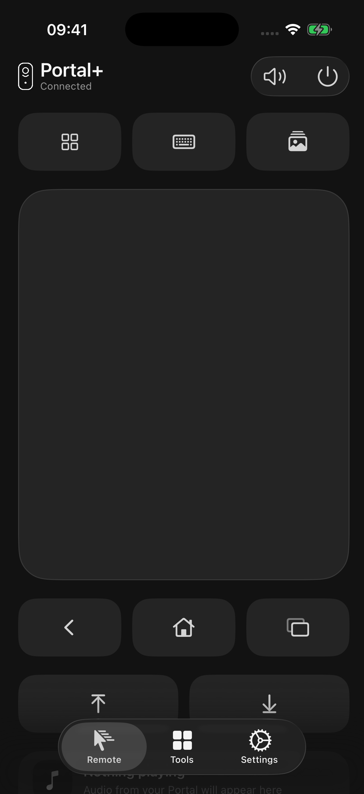
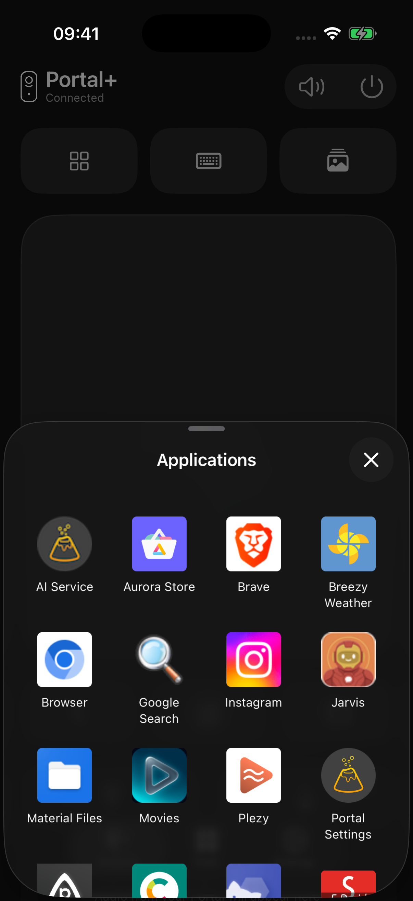
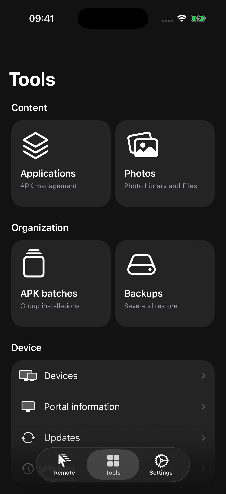

<p align="center">
  
</p>

<p align="center"><strong>Tu Portal, en tus manos.</strong></p>

<p align="center">
  Un mando nativo para iPhone y iPad.<br>
  Cursor, teclado, aplicaciones y reproducción, con herramientas ADB para gestionar tu Portal.
</p>

<p align="center">
  <a href="https://github.com/AnubisReal/Remio/releases/latest/download/Remio.ipa"></a>
  &nbsp;
  <a href="https://raw.githubusercontent.com/AnubisReal/Remio/main/distribution/source.json"></a>
</p>

<p align="center">
  <sub>iOS / iPadOS 26+ &nbsp; · &nbsp; Español e inglés &nbsp; · &nbsp; SwiftUI</sub>
</p>

<p align="center">
  
  
  
</p>

### Control y herramientas

Mueve el cursor, escribe con el teclado de iOS, abre aplicaciones y controla la reproducción. Gestiona APK, envía fotos y crea copias mediante ADB. El idioma se adapta automáticamente al dispositivo.

Necesitas un Portal con [Immortal](https://github.com/starbrightlab/immortal) en la misma Wi-Fi. Las herramientas requieren ADB habilitado y autorizado.

### Instala Remio

Descarga el [último IPA](https://github.com/AnubisReal/Remio/releases/latest) o añade esta fuente en **AltStore Classic, SideStore o LiveContainer**:

```text
https://raw.githubusercontent.com/AnubisReal/Remio/main/distribution/source.json
```

La fuente incluye el icono y se actualiza con cada release estable. La validación en hardware con cada gestor sigue pendiente.

<details>
<summary><strong>Documentación</strong></summary>

[Desarrollo](ios/README.md) · [Distribución](docs/DISTRIBUTION.md) · [Conexiones](docs/DUAL-CONNECTION.md) · [Herramientas](docs/TOOLKIT-PARITY.md)

</details>

---

<p align="center">
  <sub>Creado por AnubisReal</sub>
</p>

<p align="center">
  <a href="https://github.com/AnubisReal"></a>
  &nbsp;
  <a href="https://www.instagram.com/anubisreal/"></a>
  &nbsp;
  <a href="https://x.com/Anubisreal23"></a>
</p>

Gracias a [jurax-sys](https://github.com/jurax-sys) por [Portal Toolkit](https://github.com/jurax-sys/portal-toolkit), referencia para algunas de nuestras herramientas. ¡Un saludo y gracias por compartirlo con la comunidad!

<p align="center"><sub>Proyecto independiente, sin afiliación con Meta.</sub></p>
